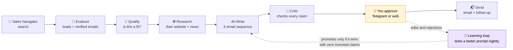
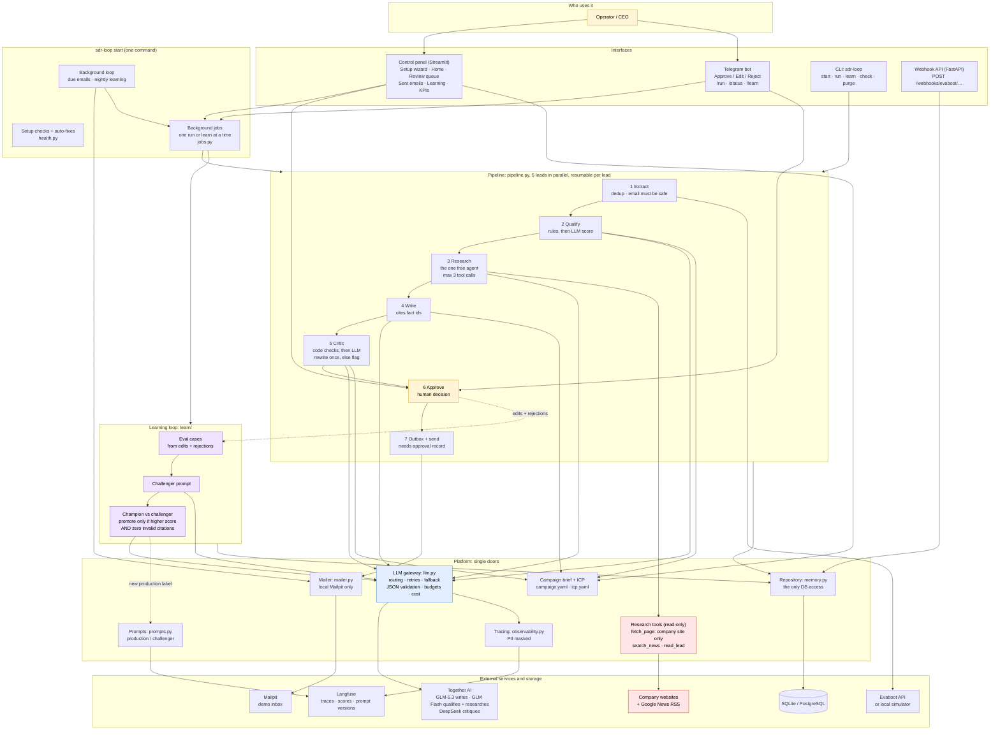

# Architecture

Two views of the same system. Use the simple one to explain the idea in a minute, and the detailed
one to walk through the code. Both are Mermaid, so GitHub renders them and they're edited as text.

## Simple: what happens to a lead

Three rules hold the whole thing together:

1. **Facts are quotes.** Research keeps a fact only if it appears word for word on a page the
   agent actually fetched. Every personal line in an email must cite one.
2. **A second model checks the first.** The critic is from a different model family than the
   writer, and an unsupported claim fails the draft, whether it's about the prospect or about us.
3. **Nothing goes out without a human.** Sending requires an approval record.

Everything is traced in Langfuse: one trace per lead, with every step, tool call, score, decision
and cost.

## Detailed: how it's built

Colours:
- **Blue:** the one door to the models.
- **Red:** where untrusted web text enters. It's wrapped as data and never treated as instructions.
- **Purple:** the learning loop.
- **Yellow:** the human.

### Why it's built this way

| Choice | Why |
|---|---|
| Fixed pipeline, one free agent | Predictable cost and easy step-level debugging. Only research needs to choose its own actions, so only research gets tools, and those are read-only and budgeted. |
| One LLM gateway | Retries, fallbacks, budgets, JSON validation and tracing in one place, so no step can skip them. |
| Facts validated in code | The model can't invent a source: a fact survives only if it's a substring of real tool output. |
| Critic from another model family | A model grading its own family's style is too lenient. |
| Brief as data, not prompt | The same (learned) prompts work for any company; claims about us get the same hard gate as claims about the prospect. |
| Human approval required | Sending is impossible without a decision record, and every decision is a training signal. |
| Runs as background jobs | A page reload or a bot restart never kills a run; the CLI stays the single code path. |
| Idempotent by lead | A crashed or budget-stopped run resumes where it stopped; nothing is sent twice. |

Every decision with its date is in [decisions.md](decisions.md).
